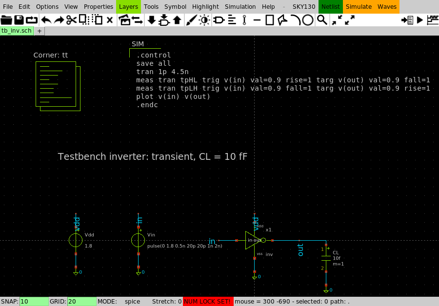
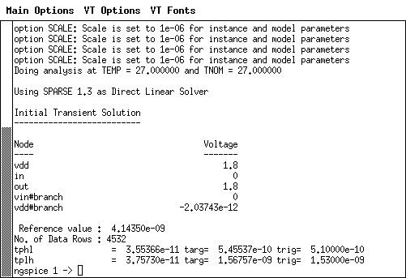
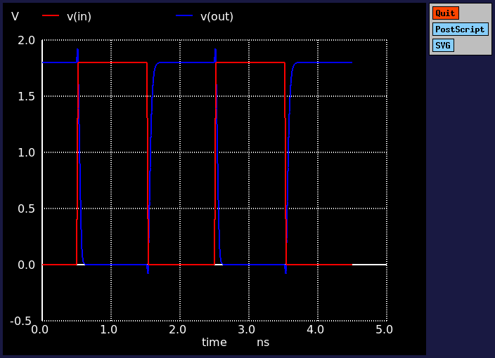

# Hướng dẫn dùng xschem cho Lab 3–5 (SKY130)

xschem là phần mềm **vẽ schematic** mã nguồn mở, đóng vai trò giống **Cadence
Virtuoso Schematic**. Bạn vẽ mạch bằng transistor lấy từ thư viện PDK SKY130.
xschem tự sinh netlist SPICE rồi gọi **ngspice** để mô phỏng (vai trò của
Spectre).

```
  Vẽ schematic (.sch)  ──►  Netlist (.spice)  ──►  ngspice mô phỏng  ──►  Dạng sóng
      xschem                  xschem tự sinh          nút Simulate          cửa sổ plot
```

## 1. Cài đặt trên máy này

xschem không có bản cài sẵn cho Windows. WSL2 cũng không bật được trên máy này.
Vì vậy xschem được **biên dịch từ mã nguồn trên Cygwin**, không cần quyền
Administrator:

| Thành phần | Vị trí |
|---|---|
| Cygwin (môi trường Linux trên Windows) | `C:\Users\ADMIN\cygwin64` |
| xschem 3.4.7 | `C:\Users\ADMIN\cygwin64\usr\local\bin\xschem` |
| X server hiển thị cửa sổ | `C:\Users\ADMIN\cygwin64\bin\XWin.exe` |
| ngspice-47 dùng cho xschem | `C:\Users\ADMIN\cygwin64\bin\ngspice.exe` |
| PDK SKY130 (symbol + model) | `C:\Users\ADMIN\.volare\...\sky130A` |

Mỗi thư mục `labN/xschem/` có sẵn file `xschemrc`. File này tự tìm PDK và nạp
thư viện symbol SKY130, nên bạn không cần cấu hình gì thêm.

## 2. Mở xschem

**Nhấp đúp `open_xschem.bat`** trong thư mục `lab3/xschem`, `lab4/xschem` hoặc
`lab5/xschem`. Script sẽ tự bật X server rồi mở testbench của lab đó.

Muốn mở một file khác, chạy từ cmd:

```
cd lab5\xschem
open_xschem.bat dff.sch
```



Các nút quan trọng nằm ở góc trên bên phải: **Netlist**, **Simulate**,
**Waves**. Menu **SKY130** chứa các tiện ích của PDK.

## 3. Các file schematic đã vẽ sẵn

| Lab | Cell (mạch thiết kế) | Symbol | Testbench |
|---|---|---|---|
| 3 | `inv.sch` | `inv.sym` | `tb_inv.sch` |
| 4 | `nand.sch` | `nand.sym` | `tb_nand.sch` |
| 5 | `dff.sch`, dùng `inv.sch` và `tgate.sch` | `dff.sym`, `inv.sym`, `tgate.sym` | `tb_dff.sch` |

Ảnh xuất sẵn nằm ở `labN/xschem/preview/`. Dạng `.svg` là ảnh vector, nên dùng
khi chèn vào báo cáo Word vì phóng to không vỡ.

Tổ chức theo **phân cấp** giống Virtuoso:
- File `.sch` là schematic mức transistor.
- File `.sym` là symbol đại diện cho schematic đó.
- Testbench dùng symbol và chỉ nối thêm nguồn và tải.
- DFF gồm các instance `inv` và `tgate`. Chọn một instance rồi bấm `e` để đi
  xuống xem mạch bên trong, bấm `Ctrl+e` để quay lên.

## 4. Mô phỏng từ schematic

1. Mở testbench, ví dụ `tb_inv.sch`.
2. Bấm **Netlist**. xschem sinh `simulation/tb_inv.spice`.
3. Bấm **Simulate**. Một cửa sổ xterm chạy ngspice, in kết quả `meas` (tpHL,
   tpLH, …), và mở cửa sổ đồ thị từ lệnh `plot` trong khối SIM.
4. Gõ `quit` trong xterm để thoát ngspice.




Khối **SIM** (dạng `code_shown`) chứa lệnh `.control`. Để sửa lệnh mô phỏng,
chọn khối đó rồi bấm `q`. Khối **Corner: tt** nạp model SKY130. Để đổi corner,
chọn khối đó, bấm `q` và sửa `corner=ff`, `ss`, `sf` hoặc `fs`.

## 5. Tự vẽ một mạch mới (ví dụ inverter)

1. `Ctrl+n` tạo schematic mới, rồi `Ctrl+s` để lưu tên, ví dụ `my_inv.sch`.
2. Bấm `Insert` rồi chọn thư mục `sky130_fd_pr`, chọn `pfet_01v8.sym`, đặt lên
   giấy. Làm tương tự với `nfet_01v8.sym`.
3. Chọn transistor, bấm `q` để sửa thuộc tính: `W=2.5`, `L=0.15` (đơn vị µm).
4. Bấm `Insert` rồi vào thư mục `devices` để lấy chân cổng:
   - `ipin.sym` cho ngõ vào, `opin.sym` cho ngõ ra, `iopin.sym` cho vdd/vss.
   - Bấm `q` trên mỗi chân để đặt tên (`lab=in`).
5. Bấm `w`, click tại điểm đầu rồi điểm cuối để vẽ dây. Hai điểm trùng nhau thì
   được nối, xschem hiện chấm tròn tại điểm nối chữ T.
6. Nhãn `lab_pin.sym` dùng để nối các điểm xa nhau: hai nhãn cùng tên là cùng
   một net.
7. Bấm `a` để xschem tự tạo symbol `.sym` từ các chân của schematic.
8. Bấm `Shift+A` để xem netlist sinh ra, và kiểm tra nối đúng chân D-G-S-B.

### Phím tắt hay dùng

| Phím | Chức năng | Phím | Chức năng |
|---|---|---|---|
| `Insert` | chèn symbol | `q` | sửa thuộc tính |
| `w` | vẽ dây | `m` | di chuyển |
| `c` | sao chép | `Delete` | xóa |
| `Shift+R` | xoay | `Shift+F` | lật ngang |
| `f` | xem toàn bộ | `z` | zoom vùng |
| `e` | đi xuống schematic con | `Ctrl+e` | quay lên |
| `n` | tạo netlist | `s` | chạy mô phỏng |
| `u` | undo | `Shift+U` | redo |
| `Ctrl+s` | lưu | `Shift+O` | đổi nền sáng/tối |
| `k` | tô sáng net đang chọn | `Shift+K` | bỏ tô sáng |
| `/` | xem toàn bộ phím tắt | `Ctrl+q` | thoát |

## 6. Xuất ảnh cho báo cáo

Từ menu **File → Image export**, chọn **PNG Export**, **SVG Export** hoặc
**PDF/PS Export**. Dùng `Shift+O` để chuyển sang nền trắng trước khi xuất.

Xuất hàng loạt bằng dòng lệnh (trong Cygwin, cần X server đang chạy):

```
cd /cygdrive/d/hoctap/fpga/verilog_school/VLSI/lab5/xschem
DISPLAY=:0 xschem -q --tcl 'set dark_colorscheme 0' \
  --command "xschem print png $PWD/preview/dff.png 2400 1600; xschem print svg $PWD/preview/dff.svg 0 0" dff.sch
```

Dùng lệnh `xschem print` như trên. Tùy chọn `--svg --plotfile` ở chế độ không
giao diện cho ra file SVG khai báo kích thước 1×1, nên hiển thị sai trong trình
xem khác. `print png` với kích thước 2400×1600 cho ảnh đủ nét để in.

## 7. Lưu ý

- **Hai luồng mô phỏng cho cùng kết quả.** Netlist viết tay (`labN/netlist/`,
  chạy bằng `sim/run.bat`) và netlist do xschem sinh ra đều dùng thư viện
  `libs.tech/combined` (model *continuous*) và có tham số vùng khuếch tán
  `ad/as/pd/ps`. Kết quả mô phỏng từ xschem vì vậy khớp với README:

  | | `sim/run.bat` | xschem |
  |---|---|---|
  | Inverter tpHL / tpLH | 35.5 / 37.6 ps | 35.5 / 37.6 ps |
  | NAND tpHL(a) / tpLH(b) | 33.1 / 54.9 ps | 33.1 / 54.9 ps |
  | DFF tcq LH / HL | 230.8 / 213.9 ps | 230.8 / 213.9 ps |

  Nếu tự vẽ mạch mới mà dùng thư viện `libs.tech/ngspice` (model
  *micro-binned*), kết quả sẽ lệch. README của PDK ghi model đó chỉ chính xác
  ở đúng các kích thước đã đo đặc tính.
- Kết nối của mọi schematic đã được kiểm tra khớp 100 % với `.subckt` trong
  `labN/netlist/`. Riêng PMOS trong `tgate` vẽ lật ngang nên chân D/S đổi chỗ.
  MOSFET đối xứng nên điều này không ảnh hưởng: mô phỏng lại cho kết quả giống
  hệt.
- Nếu cửa sổ không hiện, kiểm tra xem `XWin.exe` có đang chạy không (Task
  Manager). Có thể tắt nó rồi chạy lại `open_xschem.bat`.
