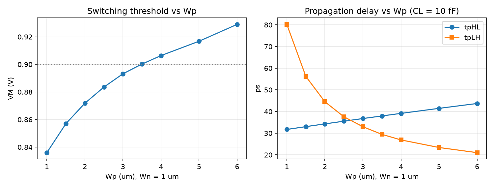
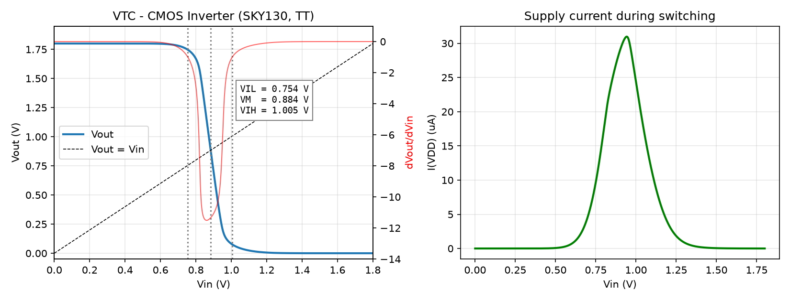
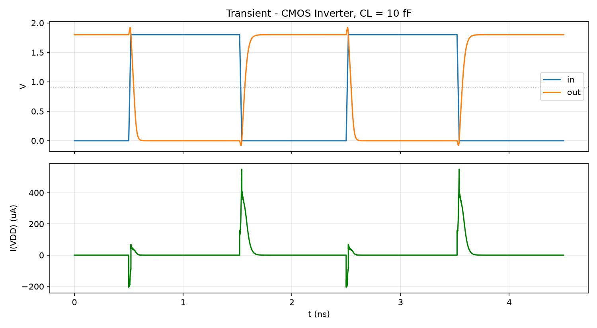
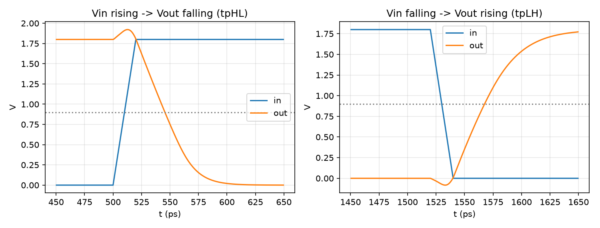
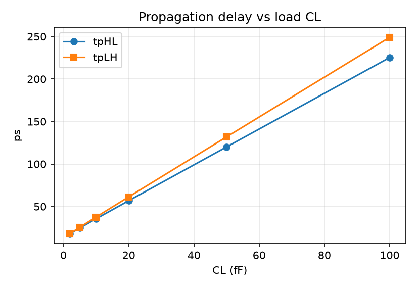
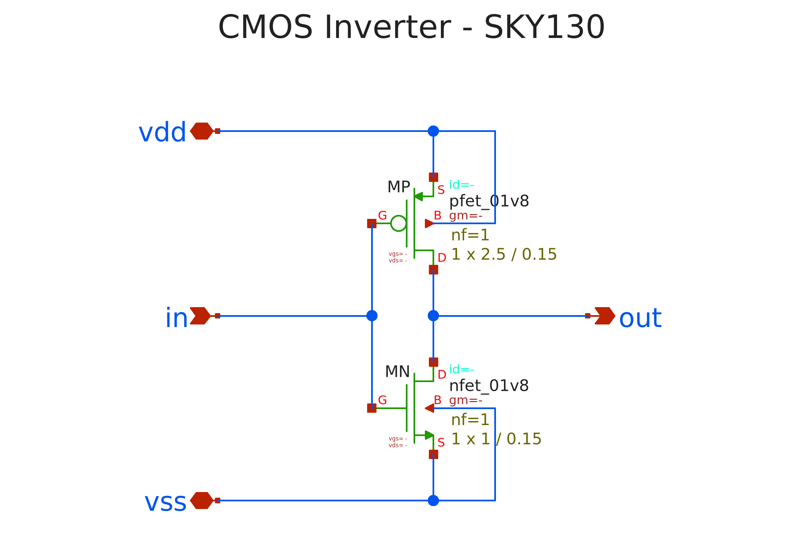
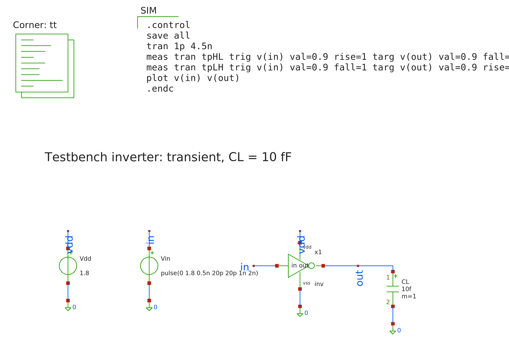
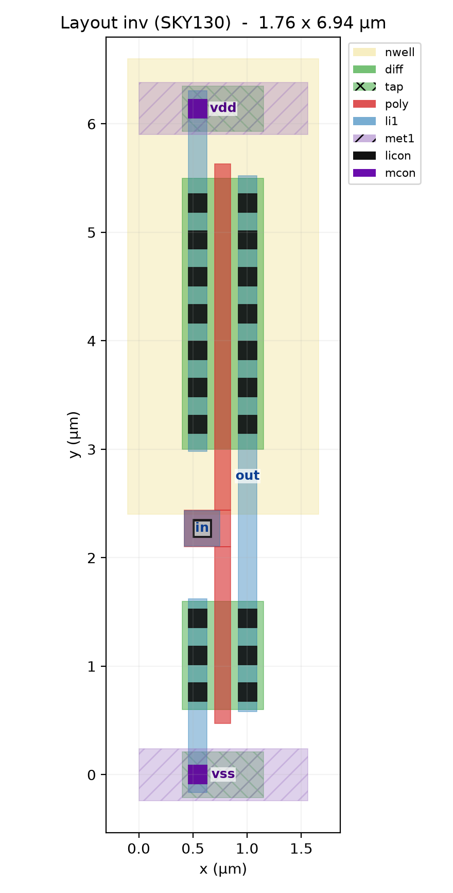

# Lab 3 — Thiết kế và phân tích CMOS Inverter (SKY130)

Môn: VLSI Design Lab — VKU
Nội dung: Thiết kế full-custom cổng đảo CMOS, mô phỏng đặc tuyến DC và đáp ứng
quá độ trên công nghệ **SkyWater SKY130** (130 nm, VDD = 1.8 V).

## I. Cơ sở lý thuyết

### Sơ đồ mạch

```
                 VDD
                  |
              |---+
     in ----o|  MP     pfet_01v8  W = 2.5 um, L = 0.15 um
              |---+
                  |
                  +-------- out
                  |
              |---+
     in -----|  MN     nfet_01v8  W = 1 um,   L = 0.15 um
              |---+
                  |
                 GND
```

Inverter CMOS gồm một PMOS nối lên VDD (pull-up) và một NMOS nối xuống GND
(pull-down), hai cực cổng nối chung làm ngõ vào, hai cực máng nối chung làm ngõ
ra.

- `in = 0`: MP dẫn, MN tắt → `out` được kéo lên VDD.
- `in = 1`: MN dẫn, MP tắt → `out` được kéo xuống GND.

Ở trạng thái tĩnh luôn có một transistor tắt nên **không có đường dẫn DC từ VDD
xuống GND**. Công suất tĩnh chỉ còn dòng rò. Dòng chỉ chảy khi chuyển mạch.

**Biểu thức Boolean:** out = in̅

| in | MP | MN | out |
|---|---|---|---|
| 0 | ON | OFF | 1 |
| 1 | OFF | ON | 0 |

### Các thông số phân tích

| Thông số | Định nghĩa |
|---|---|
| VM | Ngưỡng chuyển mạch, điểm trên VTC có Vout = Vin |
| VIL, VIH | Hai điểm trên VTC có độ dốc dVout/dVin = −1 |
| VOH, VOL | Điện áp ra tại VIL và tại VIH |
| NML, NMH | Lề nhiễu: NML = VIL − VOL, NMH = VOH − VIH |
| tpHL, tpLH | Trễ 50 %–50 % từ ngõ vào tới ngõ ra khi ra xuống / ra lên |
| tp | (tpHL + tpLH) / 2 |
| tr, tf | Thời gian lên / xuống 10 %–90 % của ngõ ra |
| Pdyn | Công suất động ≈ CL·VDD²·f |

### Chọn tỉ lệ Wp/Wn

Độ linh động của lỗ trống nhỏ hơn electron nên với cùng W, PMOS yếu hơn NMOS. Để
VTC đối xứng (VM ≈ VDD/2) và tpHL ≈ tpLH thì phải làm PMOS rộng hơn. Tỉ lệ
Wp/Wn cụ thể phụ thuộc công nghệ, nên được chọn bằng mô phỏng (testbench 1).

## II. Cấu trúc thư mục

```
lab3/
├── netlist/
│   ├── sky130_models.spice   nạp model SKY130 (corner TT)
│   └── inv.spice             subckt inverter (schematic dạng netlist)
├── tb/
│   ├── tb_sizing.sp          quét Wp -> VM, tpHL, tpLH
│   ├── tb_vtc.sp             VTC, VIL/VIH/VOL/VOH, lề nhiễu, dòng ngắn mạch
│   └── tb_tran.sp            transient: tpHL, tpLH, tr, tf, công suất; quét CL
├── sim/
│   ├── .spiceinit            cấu hình ngspice cho SKY130
│   ├── run.bat               script chạy
│   └── plot.py               vẽ đồ thị
├── results/                  ảnh kết quả (.png)
└── README.md
```

## III. Cách chạy

```
cd sim
run.bat            REM chạy cả 3 testbench rồi vẽ đồ thị (~45 s)
run.bat vtc        REM chỉ chạy 1 testbench (sizing / vtc / tran)
run.bat plot       REM chỉ vẽ lại đồ thị
run.bat clean      REM dọn dẹp
```

Hoặc gõ tay:

```
cd sim
C:\Spice64\bin\ngspice_con.exe -b ..\tb\tb_vtc.sp
python plot.py
```

Mỗi lần chạy ngspice mất khoảng 15 s để nạp thư viện model SKY130, thời gian mô
phỏng thực tế rất ngắn.

## IV. Kết quả mô phỏng

Điều kiện: corner TT, 27 °C, VDD = 1.8 V, L = 0.15 µm. Model SKY130
"continuous" (`libs.tech/combined`), có tính điện dung vùng khuếch tán
(`ad/as/pd/ps`) giống netlist xschem sinh ra.

### 1. Chọn kích thước (tb_sizing)

Wn = 1 µm cố định, tải CL = 10 fF:

| Wp (µm) | VM (V) | tpHL (ps) | tpLH (ps) |
|---|---|---|---|
| 1.0 | 0.836 | 31.7 | 80.2 |
| 1.5 | 0.857 | 33.0 | 56.2 |
| 2.0 | 0.872 | 34.3 | 44.5 |
| **2.5** | **0.884** | **35.5** | **37.6** |
| 3.0 | 0.893 | 36.8 | 33.0 |
| 3.5 | 0.900 | 38.0 | 29.5 |
| 4.0 | 0.906 | 39.1 | 26.9 |
| 5.0 | 0.917 | 41.5 | 23.4 |
| 6.0 | 0.929 | 43.7 | 21.0 |



Chọn **Wp = 2.5 µm (Wp/Wn = 2.5)**. Trong các điểm quét, đây là điểm tpHL và
tpLH gần nhau nhất: lệch 2.1 ps, trong khi ở Wp = 3 µm lệch 3.8 ps. VM = 0.884 V
cũng đã rất gần VDD/2. Muốn VM = 0.9 V chính xác thì cần Wp ≈ 3.5 µm, nhưng khi
đó diện tích và điện dung ngõ vào tăng 40 % mà lợi ích nhỏ. Tăng Wp giúp tpLH
giảm mạnh, nhưng tpHL lại tăng vì điện dung ký sinh của PMOS lớn hơn làm tăng
tải cho chính nó.

### 2. Đặc tuyến DC — VTC (tb_vtc)

```
================ KET QUA VTC INVERTER ================
vm       = 0.8835 V
vil      = 0.7544 V
vih      = 1.0054 V
vol      = 0.0756 V
voh      = 1.7465 V
nml      = 0.6788 V
nmh      = 0.7412 V
gmin     = -11.51        (độ lợi lớn nhất tại VM)
isc_peak = 30.98 uA      (dòng ngắn mạch đỉnh)
======================================================
```



- VTC chuyển mạch rất dốc, với độ lợi lớn nhất |Av| ≈ 11.5, nên inverter tái
  tạo mức logic tốt.
- VOH = 1.747 V và VOL = 0.076 V (tại hai điểm có độ dốc −1). Ngoài vùng chuyển
  mạch, ngõ ra đạt đúng rail-to-rail 1.8 V / 0 V.
- Lề nhiễu NML = 0.679 V (38 % VDD) và NMH = 0.741 V (41 % VDD) gần cân bằng.
  NMH lớn hơn NML một chút vì VM hơi thấp hơn VDD/2.
- Dòng từ VDD chỉ đáng kể trong vùng 0.5 V < Vin < 1.3 V, khi cả hai transistor
  cùng dẫn. Đỉnh 31 µA nằm gần VM, tại Vin ≈ 0.94 V. Ở hai mức logic tĩnh, dòng
  gần như bằng 0.

### 3. Đáp ứng quá độ (tb_tran)

Ngõ vào xung 0/1.8 V, cạnh 20 ps, chu kỳ 2 ns (500 MHz), CL = 10 fF.

```
============= TRANSIENT RESULTS - INVERTER (CL = 10 fF) =============
tpHL = 35.54 ps
tpLH = 37.57 ps
tp   = 36.55 ps
tr   = 63.81 ps      (10 % - 90 %)
tf   = 47.89 ps      (90 % - 10 %)
Pavg = 21.71 uW      (đo từ dòng VDD)
Pdyn = 16.20 uW      (lý thuyết CL.VDD^2.f)
===================================================================
```




- Ngõ ra đảo đúng ngõ vào, tpHL ≈ tpLH (lệch 2 ps, khoảng 6 %).
- Công suất đo được (21.7 µW) lớn hơn CL·VDD²·f (16.2 µW) khoảng 34 %. Phần
  chênh lệch gồm dòng ngắn mạch lúc chuyển mạch và điện dung ký sinh của chính
  inverter (điện dung máng và vùng khuếch tán) mà công thức lý thuyết không
  tính.
- Gai nhỏ vượt quá 1.8 V hoặc xuống dưới 0 V ngay khi ngõ vào chuyển là do
  **ghép Miller**: điện dung Cgd nối trực tiếp ngõ vào và ngõ ra.
- Dòng I(VDD) có đỉnh lớn (≈ 550 µA) ở cạnh ngõ ra lên, lúc PMOS nạp CL. Ở cạnh
  ngõ ra xuống, VDD chỉ cấp dòng ngắn mạch nhỏ, còn CL xả qua NMOS xuống GND.

### 4. Trễ theo tải (tb_tran, quét CL)

| CL (fF) | tpHL (ps) | tpLH (ps) |
|---|---|---|
| 2 | 17.8 | 18.0 |
| 5 | 24.7 | 25.5 |
| 10 | 35.5 | 37.6 |
| 20 | 56.8 | 61.3 |
| 50 | 120.1 | 131.9 |
| 100 | 225.2 | 249.0 |



Trễ tăng gần **tuyến tính** theo CL, đúng mô hình tp ≈ 0.69·Req·(Cint + CL).
Khớp đường thẳng cho độ dốc ≈ 2.2 ps/fF, suy ra Req ≈ 3.2 kΩ. Phần chắn ở
CL = 0 (≈ 14 ps) là trễ nội do điện dung ký sinh của inverter. tpLH tăng nhanh
hơn tpHL khi tải lớn, vì PMOS có Req lớn hơn NMOS một chút.

### Kết luận

Inverter CMOS SKY130 với Wn/Wp = 1/2.5 µm hoạt động đúng. VTC gần đối xứng
(VM = 0.884 V), lề nhiễu lớn (≥ 0.68 V), trễ gần cân bằng (tp ≈ 37 ps tại
10 fF) và công suất tĩnh xấp xỉ 0. Kết quả phù hợp với lý thuyết cổng CMOS
tĩnh.

## V. Ghi chú về công cụ

Slide lab yêu cầu Cadence Virtuoso + Spectre (hoặc LTspice). Ở đây dùng bộ công
cụ mã nguồn mở tương đương:

| Slide yêu cầu | Dùng ở đây |
|---|---|
| Virtuoso (schematic) | **xschem** (`xschem/*.sch`, mục VI) + netlist SPICE (`netlist/*.spice`) |
| Spectre / LTspice | **ngspice-47** (`C:\Spice64\bin\ngspice_con.exe`) |
| PDK của Cadence | **SKY130** (open_pdks, cài bằng `volare`) |
| Waveform viewer | Python + matplotlib (`sim/plot.py`) |

- PDK nằm ở
  `C:\Users\ADMIN\.volare\volare\sky130\versions\c6d73a35f524070e85faff4a6a9eef49553ebc2b\sky130A`.
  Nếu đổi chỗ thì chỉ cần sửa một dòng `.lib` trong `netlist/sky130_models.spice`.
- Muốn mô phỏng corner khác thì đổi `tt` thành `ff`, `ss`, `sf` hoặc `fs` trong
  file đó.
- Transistor dùng `sky130_fd_pr__nfet_01v8` / `sky130_fd_pr__pfet_01v8` (thiết bị
  lõi 1.8 V). Kích thước ghi bằng µm vì PDK đặt `.option scale=1e-6`.
- Cảnh báo `m=xx on .subckt line will override multiplier` là của thư viện PDK,
  vô hại.
- Model dùng thư viện `libs.tech/combined` (model "continuous", liên tục theo
  W/L), giống xschem. Thư viện `libs.tech/ngspice` là model "micro-binned": theo
  README của PDK, nó chỉ chính xác ở đúng các kích thước đã đo đặc tính. Bản
  đầu của lab này dùng thư viện đó và không có `ad/as/pd/ps`, nên trễ thấp hơn
  khoảng 15–20 %.
- Mỗi transistor có `ad/as/pd/ps` (diện tích, chu vi vùng khuếch tán S/D, tính
  với chiều dài vùng S/D 0.29 µm) để mô phỏng có điện dung tiếp giáp, giống
  netlist xschem sinh ra.

## VI. Schematic (xschem)

Thiết kế mạch được vẽ bằng **xschem** với thư viện symbol SKY130, nằm trong
thư mục `xschem/`. Cách dùng xem [HUONG_DAN_XSCHEM.md](../HUONG_DAN_XSCHEM.md).

```
xschem/
├── inv.sch / inv.sym     schematic + symbol inverter
├── tb_inv.sch            testbench: nguồn, tải 10 fF, khối mô phỏng
├── open_xschem.bat       nhấp đúp để mở xschem
├── xschemrc              cấu hình thư viện SKY130
├── simulation/           netlist do xschem sinh ra
└── preview/              ảnh .png/.svg để chèn báo cáo
```

**Schematic inverter (`inv.sch`):**



**Testbench (`tb_inv.sch`):**



Netlist do xschem sinh ra có kết nối khớp hoàn toàn với
`netlist/inv.spice`. Hai luồng dùng cùng model nên cho **cùng kết quả**:
mô phỏng `tb_inv.sch` trong xschem ra tpHL = 35.5 ps, tpLH = 37.6 ps, đúng như
mục IV.

## VII. Layout design

Layout inverter được dựng bằng script Magic [layout/inv_layout.tcl](layout/inv_layout.tcl)
(chi tiết cách dựng xem [HUONG_DAN_LAYOUT.md](../HUONG_DAN_LAYOUT.md)).
Chạy toàn bộ luồng layout: `layout\run_layout.bat`; mở trong Magic: `layout\open_magic.bat`.



- Bố cục standard cell, ô 1.56 × 6.14 µm (tính giữa tâm hai ray; kể cả nwell là 1.76 × 6.94 µm).
- NMOS (dưới) W = 1 µm, PMOS (trên, trong nwell) W = 2.5 µm, chung một gate poly dọc L = 0.15 µm.
- Source NMOS nối ray `vss`, source PMOS nối ray `vdd` qua li + mcon; drain hai transistor nối bằng cột li = `out`.
- Ngõ vào `in`: pad poly + tiếp điểm polycont + li giữa hai transistor.
- Tap nối thân: psubdiff dưới ray vss, nsubdiff dưới ray vdd.

## VIII. Verification layout design (DRC, LVS)

| Kiểm tra | Công cụ | Kết quả |
|---|---|---|
| DRC (bộ luật `drc(full)` của SKY130) | Magic | **0 lỗi** |
| LVS (layout so với `xschem/inv.sch`) | Netgen | **Circuits match uniquely** |

Netlist trích từ layout (`layout/inv_lvs.spice`):

```
.subckt inv in out vdd vss
X0 out in vdd vdd sky130_fd_pr__pfet_01v8 ad=0.75 pd=5.6 as=0.75 ps=5.6 w=2.5 l=0.15
X1 out in vss vss sky130_fd_pr__nfet_01v8 ad=0.3 pd=2.6 as=0.3 ps=2.6 w=1 l=0.15
.ends
```

## IX. Simulation post layout

Testbench `tb/tb_post.sp` mô phỏng cùng lúc 3 phiên bản (tải 10 fF):

| Phiên bản | tpHL (ps) | tpLH (ps) | tr (ps) | tf (ps) |
|---|---|---|---|---|
| pre (schematic) | 35.5 | 37.6 | 63.8 | 47.9 |
| dev (transistor từ layout, không tụ dây) | 33.9 | 35.1 | 58.5 | 44.5 |
| **post (transistor + 5 tụ ký sinh)** | **35.3** | **36.7** | **61.3** | **46.7** |

- Tụ ký sinh trích được: out–vss 0.37 fF, out–vdd 0.16 fF, in–vdd 0.13 fF, out–in 0.06 fF, vdd–vss 1.20 fF.
- Ký sinh của layout làm chậm khoảng **4 %** (dev → post). Tổng ký sinh ở ngõ ra (~0.6 fF) nhỏ so với tải 10 fF.
- dev nhanh hơn pre vì netlist schematic có ước lượng điện trở vùng khuếch tán `nrd/nrs`, Magic không xuất tham số này (xem HUONG_DAN_LAYOUT.md mục 6).
