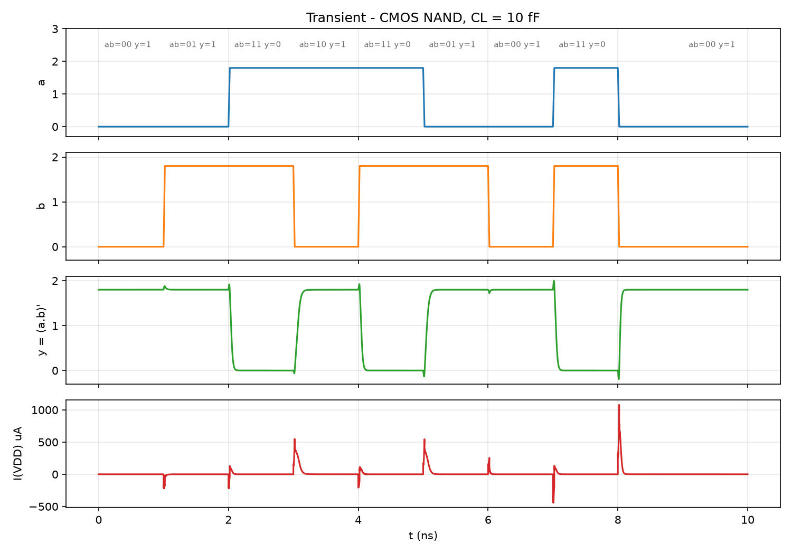
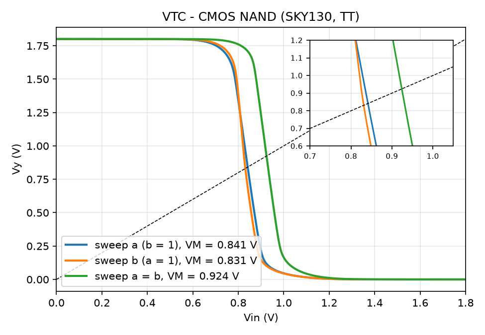
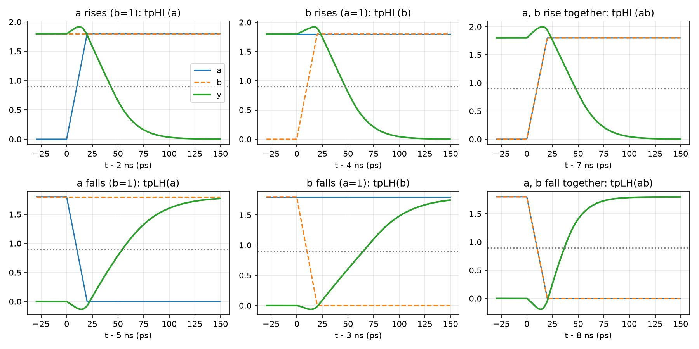
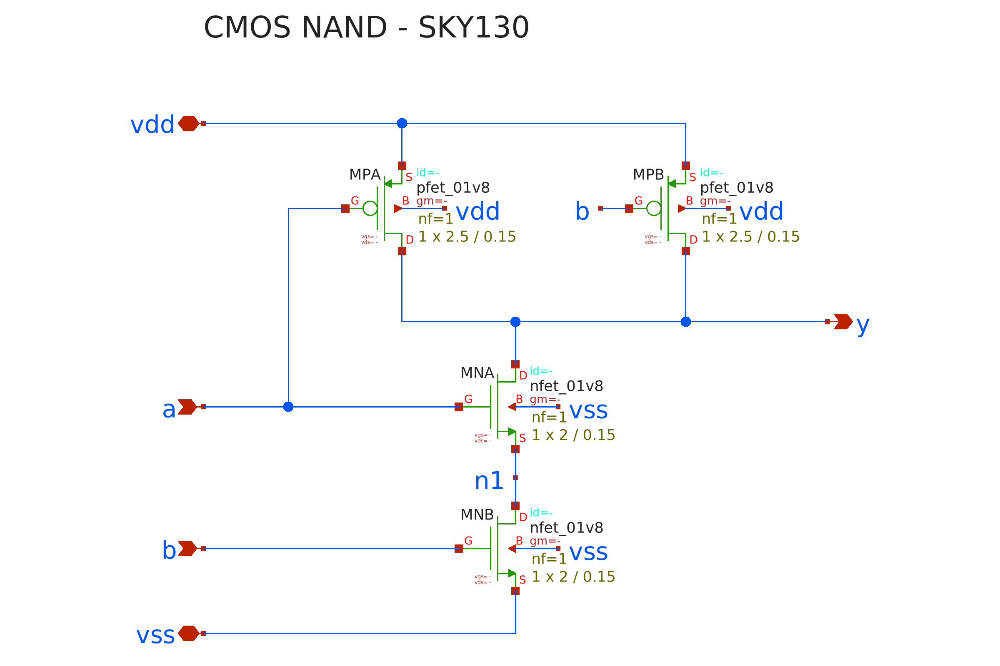
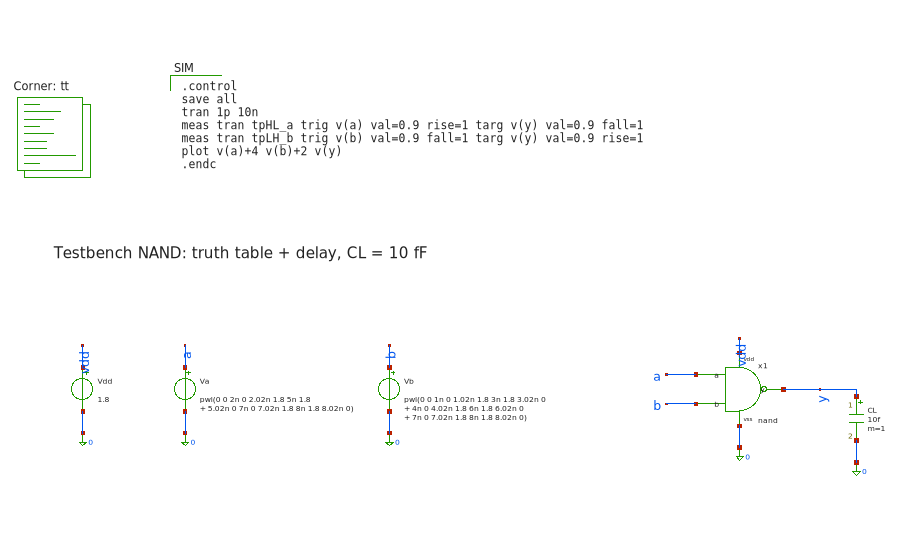
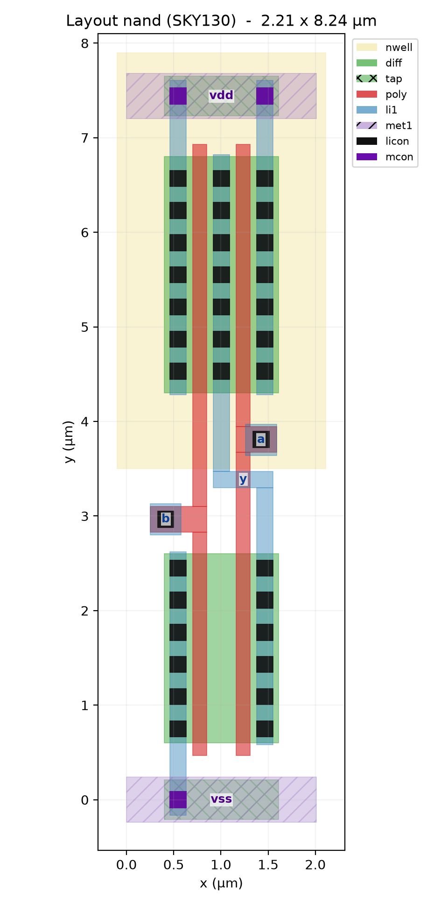

# Lab 4 — Thiết kế và phân tích cổng CMOS NAND (SKY130)

Môn: VLSI Design Lab — VKU
Nội dung: Thiết kế full-custom cổng NAND CMOS, kiểm tra bảng sự thật,
phân tích VTC và độ trễ theo từng ngõ vào trên công nghệ **SKY130** (1.8 V).

## I. Cơ sở lý thuyết

### Sơ đồ mạch

```
                VDD            VDD
                 |              |
             |---+          |---+
     a ----o|  MPA   b ---o|  MPB        2 PMOS song song (pull-up)
             |---+          |---+        W = 2.5 um
                 |              |
                 +------+-------+
                        |
                        +-------------- y = (a.b)'
                        |
                    |---+
     a ------------|  MNA                2 NMOS nối tiếp (pull-down)
                    |---+                W = 2 um
                        |  n1
                    |---+
     b ------------|  MNB
                    |---+
                        |
                       GND
```

Cổng NAND CMOS tĩnh gồm mạng **pull-up** là 2 PMOS song song và mạng
**pull-down** là 2 NMOS nối tiếp. Hai mạng này là đối ngẫu của nhau:

- Ngõ ra chỉ bị kéo xuống 0 khi **cả hai** NMOS cùng dẫn (a = b = 1).
- Chỉ cần **một** ngõ vào bằng 0 là có PMOS dẫn và ngõ ra được kéo lên 1.

**Biểu thức Boolean:** y = (a·b)' = a̅ + b̅

| a | b | MPA | MPB | MNA | MNB | y |
|---|---|---|---|---|---|---|
| 0 | 0 | ON | ON | OFF | OFF | 1 |
| 0 | 1 | ON | OFF | OFF | ON | 1 |
| 1 | 0 | OFF | ON | ON | OFF | 1 |
| 1 | 1 | OFF | OFF | ON | ON | 0 |

### Chọn kích thước

Lấy inverter chuẩn của Lab 3 (Wn = 1 µm, Wp = 2.5 µm) làm tham chiếu:

- **NMOS nối tiếp:** hai điện trở nối tiếp cộng lại, nên mỗi NMOS phải rộng gấp
  đôi (**Wn = 2 µm**) để điện trở kéo xuống bằng inverter chuẩn.
- **PMOS song song:** trường hợp xấu nhất chỉ có một PMOS dẫn, nên giữ
  **Wp = 2.5 µm** như inverter.

Transistor MNA (ngõ vào a) nằm gần ngõ ra, còn MNB (ngõ vào b) nằm gần GND. Vị
trí này làm ngõ vào a và b có độ trễ khác nhau, như phần IV sẽ cho thấy.

## II. Cấu trúc thư mục

```
lab4/
├── netlist/
│   ├── sky130_models.spice   nạp model SKY130 (corner TT)
│   └── nand.spice           subckt NAND
├── tb/
│   ├── tb_vtc.sp             VTC 3 trường hợp: quét a, quét b, quét a = b
│   └── tb_tran.sp            bảng sự thật + 6 loại trễ + công suất
├── sim/
│   ├── .spiceinit            cấu hình ngspice cho SKY130
│   ├── run.bat               script chạy
│   └── plot.py               vẽ đồ thị
├── results/                  ảnh kết quả (.png)
└── README.md
```

## III. Cách chạy

```
cd sim
run.bat            REM chạy cả 2 testbench rồi vẽ đồ thị (~30 s)
run.bat vtc        REM chỉ chạy VTC
run.bat tran       REM chỉ chạy transient
run.bat plot       REM chỉ vẽ lại
run.bat clean      REM dọn dẹp
```

## IV. Kết quả mô phỏng

Điều kiện: corner TT, 27 °C, VDD = 1.8 V, CL = 10 fF. Model SKY130 "continuous"
(`libs.tech/combined`) và có `ad/as/pd/ps`, giống Lab 3.

### 1. Kiểm tra bảng sự thật (tb_tran)

Mỗi ô thời gian dài 1 ns, lấy mẫu ở cuối ô (`truth.dat`):

```
 t(ns) |  a  |  b  |    y (V)    | y logic | mong đợi
-------+-----+-----+-------------+---------+---------
  0.8  |  0  |  0  |  1.800      |    1    |    1
  1.8  |  0  |  1  |  1.800      |    1    |    1
  2.8  |  1  |  1  |  0.0000009  |    0    |    0
  3.8  |  1  |  0  |  1.800      |    1    |    1
  4.8  |  1  |  1  |  0.0000009  |    0    |    0
  5.8  |  0  |  1  |  1.800      |    1    |    1
  6.8  |  0  |  0  |  1.800      |    1    |    1
  7.8  |  1  |  1  |  0.0000009  |    0    |    0
  9.8  |  0  |  0  |  1.800      |    1    |    1
```



Ngõ ra đúng với bảng sự thật NAND ở mọi tổ hợp và đạt đủ rail-to-rail (0 V /
1.8 V).

### 2. Đặc tuyến DC — VTC (tb_vtc)

```
================ KET QUA VTC NAND ================
 Trường hợp           VM      VIL     VIH     NML     NMH
 quét a (b = 1)     0.841   0.706   0.951   0.626   0.796
 quét b (a = 1)     0.831   0.721   0.938   0.636   0.812
 quét a = b         0.924   0.813   1.051   0.734   0.698
===================================================
```



- **Quét a = b** cho VM cao nhất (0.924 V). Khi a và b cùng lên, cả hai PMOS
  song song cùng chống lại hai NMOS nối tiếp. Mạng kéo lên mạnh gấp đôi so với
  khi chỉ một ngõ vào chuyển, nên phải đẩy Vin cao hơn mới lật được ngõ ra.
- **Quét a** có VM cao hơn **quét b** một chút (0.841 so với 0.831 V). MNA nằm
  trên, cực nguồn của nó là nút n1 > 0, nên chịu **hiệu ứng thân (body effect)**:
  Vth tăng, MNA yếu hơn, và VM bị đẩy lên.
- Lề nhiễu mọi trường hợp đều ≥ 0.62 V (35 % VDD).

### 3. Độ trễ (tb_tran)

```
============= KET QUA TRANSIENT NAND (CL = 10 fF) =============
 Cạnh                                   tpHL (ps)   tpLH (ps)
 chỉ a chuyển (b = 1), a ở MNA trên       33.06       44.46
 chỉ b chuyển (a = 1), b ở MNB dưới       37.32       54.93
 a và b cùng chuyển                       37.71       26.71
 Công suất trung bình                     16.95 uW
================================================================
```



Giải thích:

- **tpHL(a) < tpHL(b):** khi a đến sau cùng (b đã bằng 1), MNB đã dẫn từ trước và
  xả nút n1 về 0. Lúc đó chỉ cần xả điện dung ngõ ra. Ngược lại, khi b đến sau
  cùng (a đã bằng 1), n1 đã được nạp lên ≈ VDD − Vth qua MNA, nên phải xả thêm
  điện dung của n1. Đây là quy tắc thiết kế thực tế: **tín hiệu đến muộn nhất
  nên nối vào transistor gần ngõ ra nhất**.
- **tpLH(a) < tpLH(b):** khi b xuống (a = 1), MNA vẫn dẫn nên ngõ ra lên phải nạp
  cả n1. Khi a xuống, MNA tắt và cô lập n1, nên chỉ phải nạp ngõ ra.
- **tpLH(ab) nhỏ nhất (26.7 ps):** hai PMOS cùng dẫn song song nên mạnh gấp đôi.
- **tpHL(ab) lớn nhất trong nhóm tpHL (37.7 ps):** trong lúc chuyển, hai PMOS vẫn
  còn dẫn một phần và cùng chống lại mạng kéo xuống.
- So với inverter Lab 3 (tpHL = 35.5 ps, tpLH = 37.6 ps), trễ kéo xuống của NAND
  tương đương (33–38 ps) nhờ Wn = 2 µm. Trễ kéo lên xấu nhất lớn hơn nhiều
  (54.9 ps), vì ngõ ra NAND có thêm điện dung máng của PMOS thứ hai, và phải
  nạp cả nút n1.

### Kết luận

Cổng NAND CMOS SKY130 hoạt động đúng bảng sự thật với mức ra rail-to-rail. VM
thay đổi theo tổ hợp ngõ vào (0.83–0.92 V) nhưng lề nhiễu luôn ≥ 0.62 V. Trễ
phụ thuộc vào ngõ vào nào chuyển mạch và vị trí transistor trong chuỗi nối
tiếp. Trường hợp xấu nhất là tpLH khi b chuyển (54.9 ps @ 10 fF).

## V. Ghi chú về công cụ

Giống Lab 3: dùng **ngspice-47 + PDK SKY130** thay cho Cadence Virtuoso/Spectre.
Đường dẫn PDK và corner nằm trong `netlist/sky130_models.spice`. Chi tiết xem
phần V của [lab3/README.md](../lab3/README.md).

## VI. Schematic (xschem)

Thiết kế mạch được vẽ bằng **xschem**, nằm trong thư mục `xschem/`: gồm
`nand.sch`/`nand.sym`, testbench `tb_nand.sch`, và `open_xschem.bat` để mở.
Cách dùng xem [HUONG_DAN_XSCHEM.md](../HUONG_DAN_XSCHEM.md).

**Schematic NAND (`nand.sch`):**



**Testbench (`tb_nand.sch`):**



Netlist do xschem sinh ra có kết nối khớp hoàn toàn với `netlist/nand.spice`.
Hai luồng dùng cùng model nên cho **cùng kết quả**: mô phỏng `tb_nand.sch`
trong xschem ra tpHL(a) = 33.1 ps, tpLH(b) = 54.9 ps, đúng như mục IV.

## VII. Layout design

Layout NAND dựng bằng script Magic [layout/nand_layout.tcl](layout/nand_layout.tcl).
Chạy luồng: `layout\run_layout.bat`; mở trong Magic: `layout\open_magic.bat`.



- Ô 2.01 × 7.44 µm (kể cả nwell 2.21 × 8.24 µm). Hai đường poly dọc: bên trái là `b`, bên phải là `a`.
- **PMOS song song** (W = 2.5 µm): `vdd | b | y | a | vdd` – hai PMOS **dùng chung drain** `y` ở giữa.
- **NMOS nối tiếp** (W = 2 µm): `vss | b | n1 | a | y` – `n1` là vùng khuếch tán chung giữa hai gate,
  không cần tiếp điểm. MNA (gate a) nằm sát ngõ ra, MNB (gate b) sát vss, đúng như schematic.
- Ngõ ra `y`: cột li từ drain NMOS lên drain PMOS.

## VIII. Verification layout design (DRC, LVS)

| Kiểm tra | Kết quả |
|---|---|
| DRC (Magic, `drc(full)`) | **0 lỗi** |
| LVS (Netgen, so với `xschem/nand.sch`) | **Circuits match uniquely** |

```
.subckt nand a b y vdd vss
X0 y b vdd vdd sky130_fd_pr__pfet_01v8 ad=0.3875 pd=2.81 as=0.75 ps=5.6 w=2.5 l=0.15
X1 vdd a y vdd sky130_fd_pr__pfet_01v8 ad=0.75 pd=5.6 as=0.3875 ps=2.81 w=2.5 l=0.15
X2 a_170_120# b vss vss sky130_fd_pr__nfet_01v8 ad=0.31 pd=2.31 as=0.6 ps=4.6 w=2 l=0.15
X3 y a a_170_120# vss sky130_fd_pr__nfet_01v8 ad=0.6 pd=4.6 as=0.31 ps=2.31 w=2 l=0.15
.ends
```

- Drain chung của 2 PMOS: mỗi transistor chỉ tính ad = 0.3875 µm² (thay vì 0.75) → tụ ngõ ra nhỏ hơn.
- Nút n1 được Magic đặt tên `a_170_120#`; LVS vẫn khớp vì so theo cấu trúc mạch, không theo tên.

## IX. Simulation post layout

`tb/tb_post.sp`, tải 10 fF, đơn vị ps:

| Phiên bản | tpHL(a) | tpHL(b) | tpHL(ab) | tpLH(a) | tpLH(b) | tpLH(ab) |
|---|---|---|---|---|---|---|
| pre | 33.1 | 37.3 | 37.7 | 44.5 | 54.9 | 26.7 |
| dev | 29.6 | 33.0 | 34.1 | 39.8 | 48.1 | 24.3 |
| **post (11 tụ ký sinh)** | **31.2** | **34.4** | **35.9** | **42.0** | **50.2** | **25.5** |

- Bảng sự thật trên bản post-layout: đúng cả 9 mẫu, ngõ ra 1.8 V / ≈ 0 V.
- Ký sinh làm chậm khoảng **5 %** (dev → post). Các quan hệ đã phân tích ở mục IV vẫn giữ nguyên
  (tpHL(a) < tpHL(b), tpLH(ab) nhỏ nhất, xấu nhất là tpLH(b)).
- dev nhanh hơn pre khoảng 10 %: ngoài `nrd/nrs`, layout dùng chung diffusion nên tụ tiếp giáp nhỏ hơn ước lượng.
