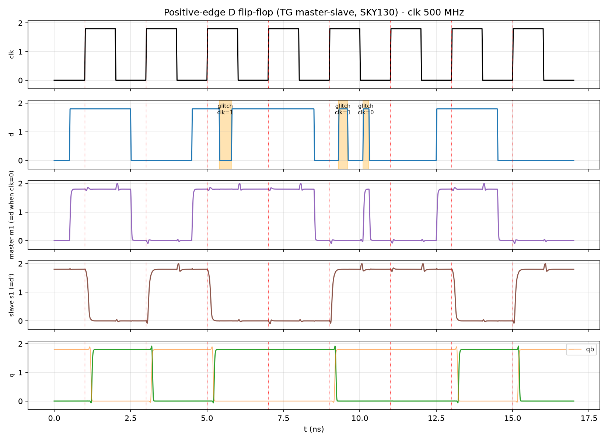
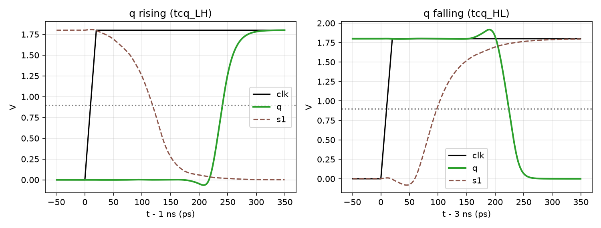
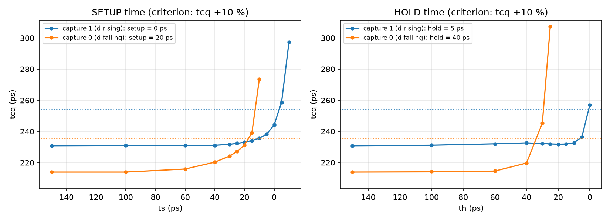
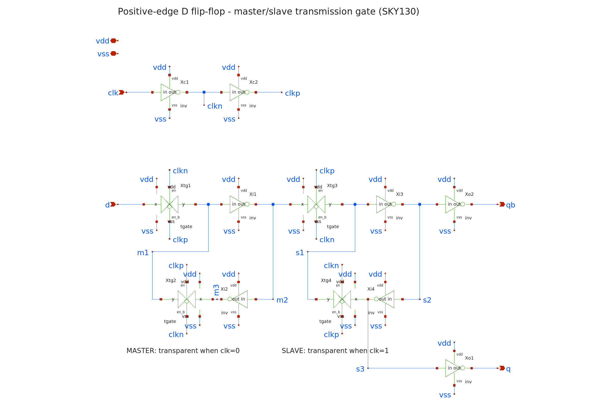
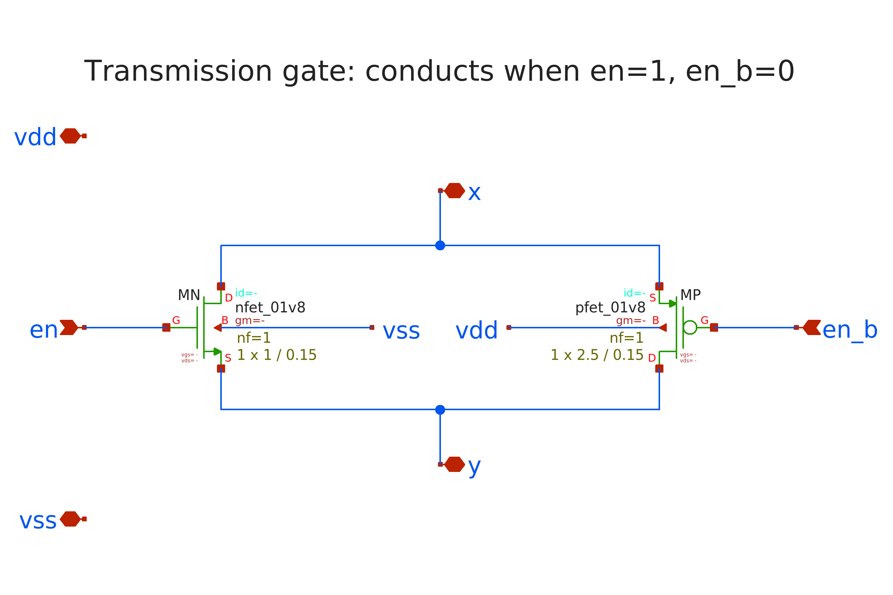
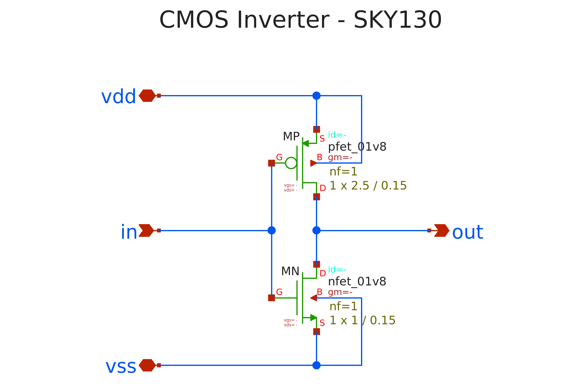
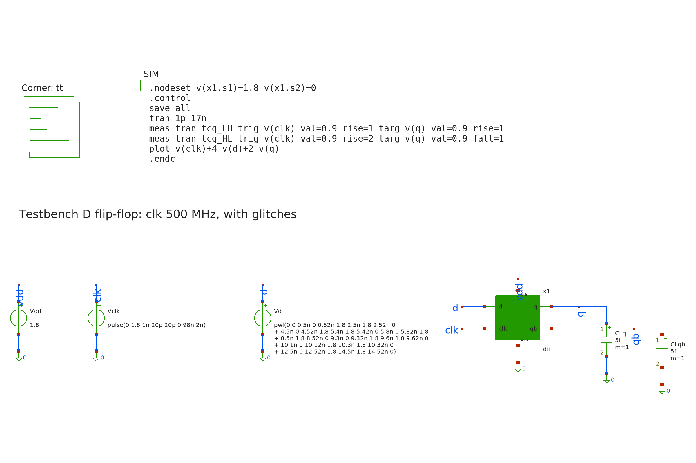
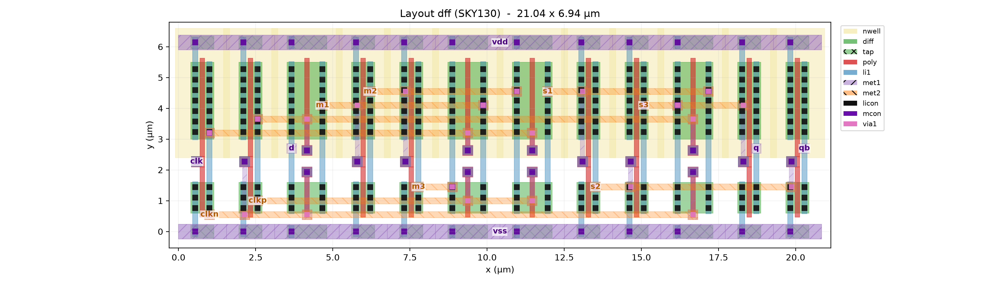
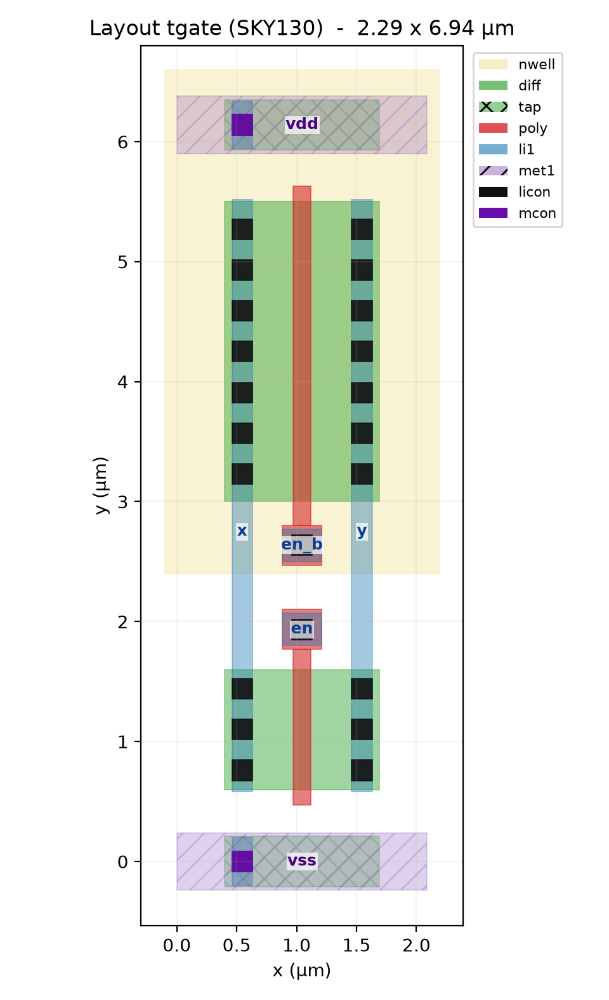

# Lab 5 — Thiết kế và phân tích CMOS D Flip-Flop (SKY130)

Môn: VLSI Design Lab — VKU
Nội dung: Thiết kế full-custom D flip-flop kích cạnh lên kiểu master–slave dùng
transmission gate, kiểm tra chức năng, đo trễ clk→Q, thời gian setup và hold
trên công nghệ **SKY130** (1.8 V).

## I. Cơ sở lý thuyết

### Nguyên lý master–slave

D flip-flop kích cạnh lên được ghép từ hai **latch** mắc nối tiếp, hoạt động ở
hai pha clock ngược nhau:

| clk | Master latch | Slave latch | Q |
|---|---|---|---|
| 0 | trong suốt: bám theo D | giữ giá trị cũ | không đổi |
| 1 | giữ giá trị D tại cạnh lên | trong suốt: đưa giá trị master ra Q | = D tại cạnh lên |

Vì hai latch không bao giờ cùng trong suốt, Q chỉ thay đổi đúng tại **cạnh lên**
của clock.

**Biểu thức đặc tính:** Q(next) = D (tại cạnh lên clk)

| clk | D | Q(next) |
|---|---|---|
| ↑ | 0 | 0 |
| ↑ | 1 | 1 |
| 0, 1, ↓ | x | Q (giữ) |

### Sơ đồ mạch (24 transistor)

```
 clk --[INV]-- clkn --[INV]-- clkp            (tạo clock bù tại chỗ)

        MASTER (trong suốt khi clk=0)        SLAVE (trong suốt khi clk=1)

  d --[TG1]--+--[INV i1]--+--[TG3]--+--[INV i3]--+--[INV o2]-- qb
    clk=0    |  m1        |  m2 clk=1  s1        |  s2
             |            |         |            |
             +--[TG2]--[INV i2]--+  +--[TG4]--[INV i4]--+
                clk=1      m3          clk=0      s3
                                        s3 --[INV o1]-- q
```

- **Transmission gate (TG):** một NMOS và một PMOS mắc song song, cổng được điều
  khiển bởi hai clock ngược pha. TG truyền cả mức 0 lẫn mức 1 mà không bị sụt
  Vth.
- **Master:** TG1 mở khi clk = 0 nên m1 bám D. TG2 mở khi clk = 1 để khép vòng
  hồi tiếp i1–i2, giữ giá trị.
- **Slave:** TG3 mở khi clk = 1 để chép m2 = D̅ sang s1. TG4 mở khi clk = 0 để
  khép vòng hồi tiếp i3–i4.
- **Clock nội:** hai inverter tạo `clkn` và `clkp` ngay trong cell, nên TG luôn
  nhận cặp clock bù có độ lệch nhỏ và không phụ thuộc bên ngoài.
- **Đệm ra:** o1 và o2 cách ly nút lưu trữ khỏi tải ngoài. Nhờ vậy tải lớn không
  làm hỏng vòng hồi tiếp.

Kích thước: mọi inverter và TG dùng Wn = 1 µm, Wp = 2.5 µm, L = 0.15 µm (cùng
cỡ inverter Lab 3).

### Các thông số thời gian

| Thông số | Định nghĩa |
|---|---|
| tcq | Trễ từ cạnh lên clk (50 %) tới Q (50 %) |
| t_setup | Khoảng thời gian tối thiểu D phải ổn định **trước** cạnh clock |
| t_hold | Khoảng thời gian tối thiểu D phải giữ nguyên **sau** cạnh clock |

Tiêu chuẩn đo: D được coi là bắt đúng khi Q ra đúng giá trị **và** tcq không
tăng quá 10 % so với giá trị danh nghĩa.

## II. Cấu trúc thư mục

```
lab5/
├── netlist/
│   ├── sky130_models.spice   nạp model SKY130 (corner TT)
│   └── dff.spice             subckt inv, tgate, dff
├── tb/
│   ├── tb_func.sp            kiểm tra chức năng + glitch, tcq, công suất
│   └── tb_setup_hold.sp      quét thời điểm D -> setup / hold (4 trường hợp)
├── sim/
│   ├── .spiceinit            cấu hình ngspice cho SKY130
│   ├── run.bat               script chạy
│   └── plot.py               tự kiểm tra PASS/FAIL + vẽ đồ thị
├── results/                  ảnh kết quả (.png)
└── README.md
```

## III. Cách chạy

```
cd sim
run.bat            REM chạy tất cả rồi kiểm tra + vẽ (~1 phút)
run.bat func       REM chỉ chạy kiểm tra chức năng
run.bat sh         REM chỉ chạy đo setup / hold
run.bat plot       REM chỉ kiểm tra + vẽ lại
run.bat clean      REM dọn dẹp
```

## IV. Kết quả mô phỏng

Điều kiện: corner TT, 27 °C, VDD = 1.8 V, clk 500 MHz (chu kỳ 2 ns, cạnh 20 ps),
tải 5 fF trên q và qb.

### 1. Kiểm tra chức năng (tb_func)

Chuỗi D lấy mẫu tại 8 cạnh lên là `1 0 1 1 0 0 1 0`. Thêm 3 xung nhiễu (glitch)
để chứng minh flip-flop chỉ nhạy với cạnh:

| Glitch | Thời điểm | clk | Kỳ vọng |
|---|---|---|---|
| D: 1→0→1 | 5.4–5.8 ns | 1 | master đang giữ nên Q không đổi (giữ 1) |
| D: 0→1→0 | 9.3–9.6 ns | 1 | master đang giữ nên Q không đổi (giữ 0) |
| D: 0→1→0 | 10.1–10.3 ns | 0 | master bám theo nhưng hết trước cạnh 11 ns, Q giữ 0 |

Kết quả tự kiểm tra của `plot.py`, với Q được xét trong cả chu kỳ sau mỗi cạnh:

```
  Canh(ns)  D@canh  Q mong doi  Q min..max trong chu ky   Ket qua
       1     1         1         1.783 ..  1.803       PASS
       3     0         0        -0.001 ..  0.003       PASS
       5     1         1         1.783 ..  1.803       PASS
       7     1         1         1.796 ..  1.803       PASS
       9     0         0        -0.001 ..  0.003       PASS
      11     0         0        -0.001 ..  0.003       PASS
      13     1         1         1.783 ..  1.803       PASS
      15     0         0        -0.001 ..  0.001       PASS
  ==> CHUC NANG: DUNG
```



Trên dạng sóng:

- Nút master `m1` bám D khi clk = 0, kể cả glitch ở 10.1 ns, và bị khóa khi
  clk = 1: hai glitch ở 5.4 ns và 9.3 ns không lọt vào.
- Nút slave `s1` (= D̅) chỉ đổi ngay sau cạnh lên.
- Q thay đổi đúng tại các cạnh lên. Cả ba glitch đều không ảnh hưởng tới Q.

### 2. Trễ clk→Q và công suất

```
============= KET QUA D FLIP-FLOP (clk 500 MHz) =============
tcq_LH = 230.8 ps     (Q lên)
tcq_HL = 213.9 ps     (Q xuống)
Pavg   = 76.4 uW
=============================================================
```



tcq ≈ 215–230 ps, tương đương khoảng 6 tầng inverter (≈ 37 ps/tầng như Lab 3).
Đường tín hiệu đi qua: 2 inverter clock → TG3 → i3 → i4 → đệm o1. Công suất
76 µW lớn hơn nhiều so với một inverter. Lý do là bộ đệm clock và 4 TG chuyển
mạch ở **mỗi** chu kỳ clock, kể cả khi D không đổi. Đây là lý do clock gating
quan trọng trong thiết kế thực tế.

### 3. Setup time và hold time (tb_setup_hold)

Quét thời điểm D đổi quanh cạnh clock với bước 5 ps. Đo cho cả hai chiều: bắt
mức 1 (D lên) và bắt mức 0 (D xuống).



```
  tcq danh nghia : LH = 230.8 ps, HL = 213.9 ps
  Setup time     : d len 0 ps, d xuong 20 ps -> t_setup = 20 ps
  Hold time      : d len 5 ps, d xuong 40 ps -> t_hold  = 40 ps
```

| | D lên (bắt 1) | D xuống (bắt 0) | **Kết luận (xấu nhất)** |
|---|---|---|---|
| Setup | 0 ps | 20 ps | **t_setup ≈ 20 ps** |
| Hold | 5 ps | 40 ps | **t_hold ≈ 40 ps** |

Nhận xét:

- Khi D đổi càng gần cạnh clock, tcq càng tăng: latch master chưa kịp ổn định
  trước khi khóa, nên slave phải "tái tạo" mức logic lâu hơn. Nếu D đến quá trễ
  thì flip-flop bắt sai giá trị. Đồ thị có dạng "vách" rất dốc, đúng như lý
  thuyết.
- **Setup rất nhỏ** (0 ps với D lên, 20 ps với D xuống). TG1 không đóng ngay
  tại cạnh clk mà đóng sau hai tầng inverter tạo `clkn`/`clkp` (≈ 30–40 ps).
  D đến sát cạnh clk vẫn kịp lọt vào master.
- **Hold dương** (40 ps) cũng vì lý do đó: TG1 còn mở thêm một khoảng sau cạnh
  clk, nên D phải giữ nguyên trong khoảng này để giá trị mới không ghi đè giá
  trị vừa lấy mẫu. Đây là đặc trưng của flip-flop TG có bộ đệm clock nội. Khi
  dùng trong thiết kế đồng bộ, phải đảm bảo trễ nhỏ nhất của logic giữa hai
  flip-flop lớn hơn t_hold.
- Cửa sổ lấy mẫu (setup + hold) ≈ 60 ps.

### Kết luận

D flip-flop master–slave TG 24 transistor trên SKY130 hoạt động đúng. Nó lấy mẫu
D tại cạnh lên và miễn nhiễm với thay đổi của D ngoài cạnh. Các thông số chính
tại TT/27 °C/1.8 V: tcq ≈ 231 ps, t_setup ≈ 20 ps, t_hold ≈ 40 ps, công suất
≈ 76 µW @ 500 MHz.

## V. Ghi chú về công cụ

Giống Lab 3: dùng **ngspice-47 + PDK SKY130** thay cho Cadence Virtuoso/Spectre,
với model "continuous" (`libs.tech/combined`) và có `ad/as/pd/ps`. Chi tiết xem
phần V của [lab3/README.md](../lab3/README.md).

- `.nodeset` trong testbench gợi ý trạng thái ban đầu cho latch slave. Nếu không
  có, bộ giải DC có thể rơi vào điểm cân bằng không bền (metastable, cả vòng
  latch ở ≈ VDD/2). Giá trị Q thực sự được xác định từ cạnh clock đầu tiên
  (1 ns).
- Trong `tb_setup_hold.sp`, mỗi điểm quét dùng `alterparam` + `reset`. Toàn bộ
  76 lần mô phỏng mất khoảng 45 s.

## VI. Schematic (xschem)

Thiết kế mạch được vẽ bằng **xschem** theo phân cấp, nằm trong thư mục
`xschem/`:

```
tb_dff.sch ──► dff.sym ──► dff.sch ──┬──► inv.sym   ──► inv.sch   (PMOS + NMOS)
                                     └──► tgate.sym ──► tgate.sch (NMOS // PMOS)
```

Mở bằng `open_xschem.bat`. Chọn một instance rồi bấm `e` để đi xuống, bấm
`Ctrl+e` để quay lên. Cách dùng xem [HUONG_DAN_XSCHEM.md](../HUONG_DAN_XSCHEM.md).

**Schematic D flip-flop (`dff.sch`):**



**Transmission gate (`tgate.sch`) và inverter (`inv.sch`):**




**Testbench (`tb_dff.sch`):**



Netlist do xschem sinh ra có kết nối khớp hoàn toàn với `netlist/dff.spice`.
Các nút nội bộ được đặt nhãn `m1`–`m3`, `s1`–`s3`, nên `.nodeset v(x1.s1)` vẫn
dùng được. Hai luồng dùng cùng model nên cho **cùng kết quả**: mô phỏng
`tb_dff.sch` trong xschem ra tcq = 230.8 / 213.9 ps, đúng như mục IV.

## VII. Layout design

Layout D flip-flop dựng bằng script Magic [layout/dff_layout.tcl](layout/dff_layout.tcl), phân cấp giống
schematic. Chạy luồng: `layout\run_layout.bat`; mở trong Magic: `layout\open_magic.bat` (hoặc
`open_magic.bat tgate`, `open_magic.bat inv`).



- **Cell `inv`**: giống hệt layout Lab 3 (1.56 µm). **Cell `tgate`** (2.09 µm, hình dưới): NMOS W = 1 và
  PMOS W = 2.5 song song giữa hai cột li `x`, `y`; **hai gate poly tách rời** – `en` (NMOS, dưới) và `en_b` (PMOS, trên).
- 12 instance xếp một hàng theo thứ tự `Xc1 Xc2 Xtg1 Xi1 Xi2 Xtg2 Xtg3 Xi3 Xi4 Xtg4 Xo1 Xo2`, dùng chung ray
  vdd/vss. Kích thước 20.84 × 6.14 µm (kể cả nwell 21.04 × 6.94 µm).
- Dây nối giữa các cell: **metal2 ngang** trên 7 track, **metal1 dọc** (stub) xuống chân cell, qua mcon và via1:
  - Track dưới: `clkn`, `clkp`, `m3`/`s2` (dùng chung track, hai đoạn không chồng nhau).
  - Track trên: `clkn`, `clkp`, `m1`/`s3`, `m2`/`s1`.
  - Pad `en` của TG chỉ đi xuống được, `en_b` chỉ đi lên được, nên mỗi clock có cả track dưới lẫn trên; hai
    track nối với nhau qua cột li ngõ ra của inverter tạo clock.
- Các net nội bộ được đặt nhãn (m1…s3, clkn, clkp) để netlist trích ra có tên giống schematic.



## VIII. Verification layout design (DRC, LVS)

| Kiểm tra | Kết quả |
|---|---|
| DRC (Magic, `drc(full)`, toàn bộ dff gồm cell con) | **0 lỗi** |
| LVS phân cấp (Netgen, so với `xschem/dff.sch`) | `inv`, `tgate`, `dff` đều **match uniquely** |

Netlist cấp `dff` trích từ layout đọc giống hệt schematic:

```
XXtg1 d m1 clkn clkp vdd vss tgate      XXi1 m1 m2 vdd vss inv
XXtg2 m3 m1 clkp clkn vdd vss tgate     XXi2 m2 m3 vdd vss inv
XXtg3 m2 s1 clkp clkn vdd vss tgate     XXi3 s1 s2 vdd vss inv
XXtg4 s3 s1 clkn clkp vdd vss tgate     XXi4 s2 s3 vdd vss inv
XXc1 clk clkn vdd vss inv   XXc2 clkn clkp vdd vss inv   XXo1 s3 q vdd vss inv   XXo2 s2 qb vdd vss inv
```

## IX. Simulation post layout

`tb/tb_post.sp` (cùng clk, d và 3 glitch như tb_func, tải 5 fF):

| Phiên bản | tcq LH (ps) | tcq HL (ps) | Chức năng (Q = D tại cạnh) |
|---|---|---|---|
| pre | 230.8 | 213.9 | 8/8 |
| dev | 223.6 | 212.3 | 8/8 |
| **post (92 tụ ký sinh)** | **282.4** | **257.8** | **8/8** |

- Mạch vẫn đúng chức năng sau layout, nhưng tcq tăng **26 %** (dev → post), nhiều hơn hẳn inverter/NAND (4–5 %).
- Nguyên nhân: tụ ký sinh tập trung ở **hai net clock** – clkn 3.65 fF, clkp 2.96 fF (các net dữ liệu 0.1–1 fF).
  Mỗi clock chạy hai track metal2 dài ~15 µm tới 4 TG, nhưng chỉ được kéo bởi inverter nhỏ nhất (Wn = 1 µm),
  mà đường clock nằm trên đường găng của tcq (clk → Xc1 → clkn → Xc2 → clkp → TG3).
- Cách cải thiện: tăng kích thước Xc1/Xc2 (clock buffer), đặt buffer clock ở giữa hàng để rút ngắn dây,
  hoặc sắp lại thứ tự cell để hai net clock ngắn hơn.
